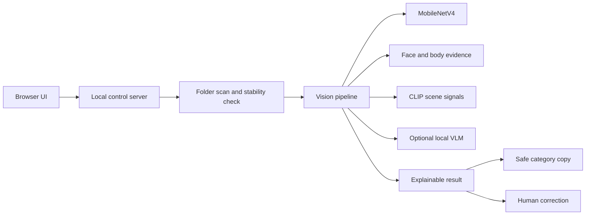

# LensSort AI

<p align="center">
  <strong>Photo triage without the black box.</strong><br />
  A local-first AI workspace for sorting photo folders, reviewing uncertain results, and keeping the originals safe.
</p>

<p align="center">
  <a href="https://github.com/Old-Doggy/lenssort-ai/actions/workflows/validate.yml"></a>
  
  
  
</p>

<p align="center">
  <a href="README.zh-CN.md">中文文档</a> ·
  <a href="docs/architecture-and-demo-flow.md">Architecture</a> ·
  <a href="docs/architecture-and-demo-flow.md">Demo flow</a>
</p>

<p align="center">
  
</p>

## The short version

LensSort AI watches a folder only while its local control service is running. Add photos, click **One-click sort**, and receive organized copies in understandable categories such as `Single person`, `Multiple people`, `People + scenery`, `Scenery`, `Animals`, `Plants`, `Other`, and `Needs review`.

It is deliberately not a magic black box:

- uncertain evidence can become `Needs review`;
- every result has an explainable evidence trail;
- a human can correct a label from the browser;
- original files are never moved, renamed, deleted, or uploaded.

## Why it is different

| Product idea | What it means in practice |
| --- | --- |
| **Local-first** | Photos stay on the selected computer. Optional visual-language review also runs through a local Ollama service. |
| **Evidence before confidence** | Face, body, scene, subject, quality, and model signals are kept separate instead of being collapsed into one misleading score. |
| **Abstention is a feature** | Statues, toys, posters, hands, masks, rotation, blur, and contradictory signals can trigger manual review. |
| **Human correction loop** | Change a category in the browser; only the output copy is moved. The source stays untouched. |
| **Hardware-aware** | CPU, integrated GPU, discrete GPU, and Windows ML/NPU paths are detected and reported with evidence. |
| **Practical scale** | Designed for personal folders of hundreds of photos, with bounded memory use and visible progress. |

## What you can do

```text
Choose folders → Add photos → One-click sort → Review the uncertain cards
       ↑                                                   ↓
       └────────────── originals stay safe ← correct a label
```

### Classification

- Detect people with face and body evidence, including conservative handling of masks and rotated photos.
- Separate real people from statues, toys, posters, screens, and other depicted subjects.
- Combine scene and subject signals for scenery, animals, plants, and mixed people/scenery photos.
- Copy results into category folders without changing the source folder.

### Assisted recommendations

The recommendation view is intentionally called **assisted** rather than “the best photos”. It can use technical quality, subject sharpness, similarity groups, and an optional aesthetic model to reduce review time. It does not claim to understand personal taste.

### Human control

- Inspect a large preview and the model explanation.
- Change the category when the model is wrong.
- Refresh against the actual folder contents instead of trusting stale browser state.
- Stop a run explicitly; the service does not install a startup task by default.

## Runtime architecture



The core stack is React + Vite on the front end and a Node.js local control service for folder operations. Model assets are downloaded or repaired locally, verified with SHA-256, and excluded from Git.

## Quick start on Windows

### One-time setup

1. Install Node.js `22.12+` (Node.js 24 LTS is recommended).
2. Clone this repository.
3. Open the project folder and double-click `首次安装.cmd`.
4. At the final prompt, choose `Y` to prepare the optional local Qwen 3.5 4B vision model now, or choose `N` to keep basic classification only. You can run `安装本地视觉模型.cmd` later.

The installer runs dependency installation, base model setup, browser setup, and a production build. The vision-model download is an explicit optional step because it uses several GB of disk space. It does not install a startup service.

### Daily use

1. Double-click `启动网页控制.cmd`.
2. Keep the service window open.
3. Open the local URL shown by the launcher, normally `http://127.0.0.1:4317`.
4. Select a source folder and an output folder.
5. Click **One-click sort**.

Do not double-click `index.html`: folder access and progress updates require the local control server.

### Optional local descriptions

Basic classification works without Ollama. To enable the complete local natural-language image explanation path:

1. Run `安装本地视觉模型.cmd` once after `首次安装.cmd` finishes.
2. Confirm the disk-space prompt. The script installs the official Ollama Windows package if needed.
3. The script downloads the recommended `qwen3.5:4b` vision model from Ollama and verifies it through the local service.
4. Start `启动网页控制.cmd`; the installed model becomes selectable in the browser.

The model is not bundled in Git because it is several GB and has separate model terms. The installer is repeatable and does not download a model that is already present. Use `npm run setup:vision -- --model=qwen3.5:9b` for the larger precision-first option. All image requests stay on the local Ollama service; no cloud API is configured.

## Useful commands

Run these from the project directory:

| Command | Purpose |
| --- | --- |
| `npm run doctor` | Check Node.js, Python, browser, base models, Ollama, and installed vision models |
| `npm run setup:vision` | Install Ollama if needed and prepare the recommended local vision model |
| `npm run test:all` | Run the complete regression suite |
| `npm run build` | Build the production web app |
| `npm run lint` | Run Oxlint |
| `npm run verify:models` | Verify model files and SHA-256 digests |
| `npm run verify:folder` | Verify folder sorting behavior |

## Model and hardware boundaries

- Model assets are local and are not committed to this repository.
- WebGPU/GPU/NPU availability depends on the target machine, drivers, Windows ML support, and free memory.
- The interface reports the provider it can actually verify; it does not promise that every computer has NPU support.
- NPU support is a mixed execution path when CPU operators are required. It must not be interpreted as pure-NPU inference.
- The project does not claim closed-model accuracy or independent human-annotated accuracy for every category.
- For uncertain or contradictory photos, a cautious result is preferable to a confident wrong label.

## Privacy and repository boundary

This repository is designed to be safe to publish:

- personal photos, generated outputs, model weights, caches, virtual environments, logs, and local reports are ignored;
- no API key, token, password, personal path, or private test file belongs in Git;
- all photo analysis is local by default;
- source files are protected during classification and correction;
- public documentation uses placeholders instead of machine-specific paths.

Before opening a pull request, run `git status`, inspect the staged file list, and run `npm run doctor`.

## Project status

The current scope is frozen as a practical engineering prototype: local folder classification, progress feedback, manual correction, safe output handling, model lifecycle controls, hardware evidence, and regression coverage are implemented. Recognition remains conservative in difficult cases, and assisted recommendations are not a substitute for personal taste.

Latest local validation: `134/134` Node tests passed, production build passed, model verification passed `21/21`, and project doctor passed.

## Contributing

Small, focused pull requests are welcome. Please read `CONTRIBUTING.md` before changing the classifier, model lifecycle, or folder-write behavior. Do not include real photos, model binaries, generated artifacts, personal paths, or secrets in issues and pull requests.

For security-sensitive reports, use the private process in `SECURITY.md` rather than opening a public issue.

## License

The application source is released under the MIT License. See `LICENSE`.

Third-party model files and dependencies may have separate licenses and redistribution terms. See `docs/model-sources.md` and `public/models/README.md` before redistributing model assets.
