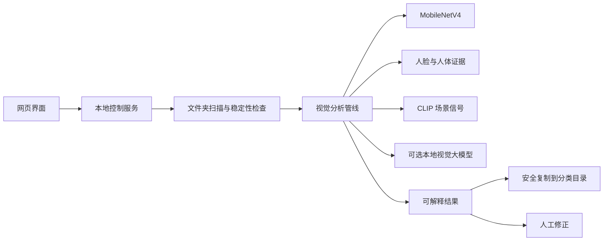

# LensSort AI

<p align="center">
  <strong>不把照片整理交给黑箱。</strong><br />
  一个本地优先的 AI 照片整理工作台：自动分类、解释结果、保留人工判断，并保护原图。
</p>

<p align="center">
  <a href="https://github.com/Old-Doggy/lenssort-ai/actions/workflows/validate.yml"></a>
  
  
  
</p>

<p align="center">
  <a href="README.md">English</a> ·
  <a href="docs/architecture-and-demo-flow.md">架构与演示流程</a> ·
  <a href="docs/architecture-and-demo-flow.md">演示流程</a>
</p>


## 一句话介绍

LensSort AI 只会在本地控制服务运行期间监听指定文件夹。把照片放入来源目录，点击 **一键筛选**，系统会将照片复制到易理解的分类目录，例如：`单人`、`多人`、`人物与风景`、`风景`、`动物`、`植物`、`其他` 和 `待确认`。

它不是一个假装无所不知的黑箱：

- 证据不足时可以进入“待确认”；
- 每张照片都保留可解释的分析依据；
- 用户可以直接在网页上修正分类；
- 原图不会被移动、改名、删除或上传。

## 设计重点

| 设计原则 | 实际表现 |
| --- | --- |
| **本地优先** | 照片留在用户选择的电脑中；可选的视觉语言复核也通过本地 Ollama 服务运行。 |
| **先看证据，再谈置信度** | 人脸、人体、场景、主体、质量和模型信号分开保存，避免压成一个容易误导的分数。 |
| **允许拒答** | 雕像、玩偶、海报、屏幕、手部、口罩、旋转、模糊和冲突证据可以触发人工确认。 |
| **人工纠错闭环** | 网页修改标签时只移动输出副本，来源照片保持不变。 |
| **适配硬件** | 检测并报告 CPU、核显、独显及 Windows ML/NPU 路径，而不是假设所有电脑都支持 NPU。 |
| **面向实际相册** | 针对几百张照片的整理场景，提供有限内存策略和清晰进度反馈。 |

## 使用流程

```text
选择文件夹 → 放入照片 → 一键筛选 → 查看待确认结果
     ↑                                      ↓
     └──────── 原图保持不变 ← 网页修正分类
```

### 自动分类

- 使用人脸和人体证据识别人像，并对口罩、旋转照片等情况采取保守策略。
- 区分真人与雕像、玩偶、海报、屏幕等被拍摄的人形对象。
- 融合场景和主体信号，识别风景、动物、植物以及人物与环境合照。
- 将结果复制到分类目录，不改变来源目录。

### 辅助推荐

项目将“精选”定位为 **辅助推荐**，而不是“替你决定最好看的照片”。它可以综合技术质量、主体清晰度、相似组和可选审美模型，减少人工浏览时间，但不宣称理解每个人的审美偏好。

### 人工控制

- 查看大图和模型解释；
- 发现错误后直接修改分类；
- 刷新时以磁盘当前内容为准，不依赖过期网页状态；
- 手动停止当前任务；默认不安装开机启动或后台常驻服务。

## 技术架构



前端使用 React + Vite，Node.js 本地控制服务负责文件夹访问、进度和安全复制。模型资源在本机下载或修复，并用 SHA-256 校验；模型权重不会进入 Git。

## Windows 快速开始

### 首次安装

1. 安装 Node.js `22.12+`，推荐 Node.js 24 LTS；
2. 克隆本仓库；
3. 打开项目文件夹，双击 `首次安装.cmd`。

安装脚本会完成依赖、模型、浏览器运行时和生产构建准备，不会安装开机启动服务。

### 日常使用

1. 双击 `启动网页控制.cmd`；
2. 保持服务窗口打开；
3. 在 Chrome 或 Edge 打开启动器显示的本地地址，通常为 `http://127.0.0.1:4317`；
4. 选择来源文件夹和输出文件夹；
5. 点击 **一键筛选**。

不要直接双击 `index.html`：文件夹访问和进度更新需要本地控制服务。

### 可选的自然语言描述

基础分类不依赖 Ollama。如果需要自然语言图片解释，可以安装 Ollama 和兼容的本地视觉模型。项目不会把照片发送到云端 API。

## 常用命令

在项目目录执行：

| 命令 | 用途 |
| --- | --- |
| `npm run doctor` | 检查 Node.js、Python、浏览器、模型和 Ollama |
| `npm run test:all` | 运行完整回归测试 |
| `npm run build` | 构建生产网页 |
| `npm run lint` | 执行 Oxlint |
| `npm run verify:models` | 校验模型文件和 SHA-256 |
| `npm run verify:folder` | 验证文件夹分类行为 |

## 模型和硬件边界

- 模型资源只在本地使用，不提交到本仓库；
- WebGPU、GPU、NPU 是否可用取决于目标电脑的驱动、Windows ML 支持和可用内存；
- 网页只展示能够实际验证到的推理提供程序，不承诺所有电脑都有 NPU；
- 当模型包含 CPU 辅助算子时，NPU 路径属于混合执行，不能描述为纯 NPU 推理；
- 项目不宣称达到闭源模型精度，也不宣称已完成覆盖所有类别的独立真人标注评测；
- 对矛盾或不确定的照片，保守进入“待确认”优于自信地给出错误标签。

## 隐私与公开边界

本仓库按公开发布设计：

- 个人照片、输出结果、模型权重、缓存、虚拟环境、日志和本地报告均被 Git 忽略；
- API 密钥、令牌、密码、个人路径和私有测试文件不应进入 Git；
- 默认所有照片分析都在本地完成；
- 分类和纠错过程保护来源文件；
- 公开文档使用通用占位符，不暴露机器路径。

提交变更前请执行 `git status`，检查暂存文件列表，并运行 `npm run doctor`。

## 项目状态

当前范围已收口为一个可运行的工程测试版：本地文件夹分类、进度反馈、人工纠错、安全输出、模型生命周期控制、硬件证据和回归测试均已实现。复杂场景仍采用保守识别，辅助推荐也不替代个人审美判断。

最近一次本机验证：`134/134` 项 Node 测试通过，生产构建通过，模型资源校验 `21/21` 通过，项目体检通过。

## 参与贡献

欢迎提交小而聚焦的 Pull Request。修改分类器、模型生命周期或文件夹写入逻辑前，请先阅读 `CONTRIBUTING.md`。Issue 和 Pull Request 中不要包含真实照片、模型二进制、生成物、个人路径或密钥。

安全问题请按照 `SECURITY.md` 的私下报告流程提交，不要直接公开漏洞细节。

## 许可证

应用源代码采用 MIT License，详见 `LICENSE`。

第三方模型文件和依赖可能拥有独立许可证及再分发条款。重新分发模型资源前，请阅读 `docs/model-sources.md` 和 `public/models/README.md`。
