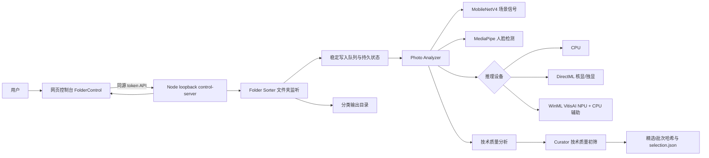
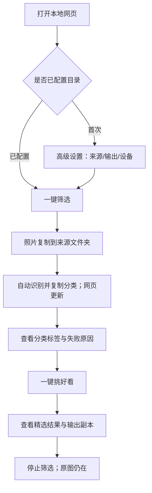
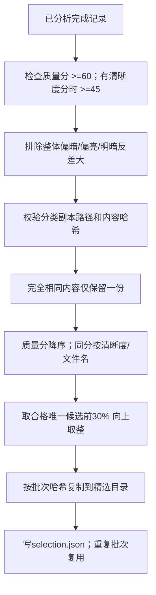

# LensSort AI 架构与演示流程

## 1. 系统架构

## 2. 一次完整用户路径

1. 启动 `启动网页控制.cmd`，打开 `http://127.0.0.1:4317`；启动脚本会自动检查并按需启动本地 Ollama。
2. 第一次展开“高级设置”，填写来源目录、输出目录和设备。
3. 点击“一键筛选”，网页状态变为“正在自动筛选”。
4. 将照片复制到来源目录；不要在复制未完成时强制关闭服务。
5. 等待卡片出现，查看分类、质量分、设备和处理耗时。
6. 点击“一键挑好看”，查看“精选结果”标签和技术质量解释。
7. 打开输出目录确认 `精选\<批次哈希>` 副本；原图仍在来源目录。
8. 不需要开机自动启动；日常只需手动运行 `启动网页控制.cmd`。关闭网页标签不等于关闭后台服务，结束处理请点击“停止筛选”并关闭服务窗口。LensSort 只会关闭自己本次启动的 Ollama，不会关闭用户原本已运行的实例。

## 3. 2 分钟演示脚本

### 0:00–0:20 讲问题

“照片整理的痛点不是模型能不能识别一张图，而是用户不想逐张导入、手动分类和担心原图被改动。LensSort AI 把输入文件夹作为入口，照片放进去后自动完成分析和分类。”

### 0:20–0:45 展示一键筛选

展开高级设置说明一次性配置目录和设备，然后收起设置。点击“一键筛选”，复制一张公开演示照片到输入目录，等待页面自动出现分类卡片。强调：网页是日常控制入口，文件夹是自动输入入口。

### 0:45–1:10 展示解释与硬件

指向卡片上的分类、技术质量、设备和耗时。切换高级设置时说明 CPU、AMD 核显、NVIDIA 独显和 AMD NPU 都有独立推理路径；NPU 是含 CPU 辅助算子的混合执行，不包装成纯 NPU。

### 1:10–1:35 展示一键挑好看

点击“一键挑好看”，展示精选数量、精选标签和 `精选` 输出目录。说明它是清晰度/曝光/主体信号的技术质量初筛，不是审美真值；完全相同内容只保留一份。

### 1:35–2:00 讲工程能力

展示测试报告中的 1,000 文件长批、0 失败、重启 0 次重复分析和 Windows `EPERM` 修复。最后说明原图不删除、照片不上传、开机启动不是必需入口；实际使用通过手动启动网页服务，并由用户点击“一键筛选”后才开始处理。

## 4. 当前精选排序流程

没有合格候选时精选数量为 0；前 30% 是技术质量规则，不代表审美 Top-K。此图对应 `tools/photo-curator.js`，不把旧版偏好调权/相似组功能算作当前主线能力。

## 5. 演示边界

- 不使用私人照片录制公开演示；使用项目内公开样本或用户明确授权的样本。
- 不展示 F5 accuracy/F1 数字，因为六类人工标注数据尚未完成。
- 不把 NVIDIA 设备级瓦数观察说成整机功耗。
- 不把自动化浏览器脚本说成真人用户满意度。
