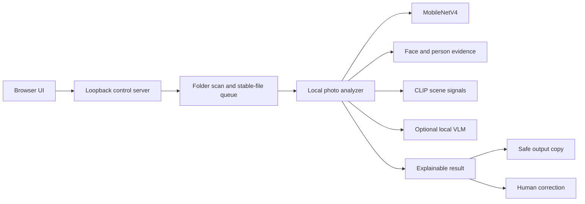

# LensSort AI 技术总览

这份文档承接 README 中不适合放在项目首页的技术细节。它记录当前实现、资源边界和验证口径，不把工程测试结果包装成真实相册准确率

## 系统结构



## Runtime layers

### Browser layer

React + Vite 提供文件夹选择、设备选择、模型设置、进度、缩略图、大图查看、分类修正和输出删除

### Local control layer

`tools/control-server.js` 只监听本机回环地址，负责：

- 选择输入和输出文件夹
- 启动和停止一次性筛选批次
- 扫描真实磁盘内容并清理失效记录
- 保存增量状态，避免重复分析
- 复制分类输出，不修改来源照片
- 启动或复用本地 Ollama，不关闭用户已有服务

### Analysis layer

- MobileNetV4：基础场景和图像信号
- MediaPipe：人脸和关键点证据
- YOLOX：人体候选证据
- CLIP：场景语义辅助
- 本地视觉语言模型：可选的自然语言解释与疑难照片复核

多种信号保持分离。证据冲突或不足时，结果进入 `待确认`，而不是伪造高置信度

## 模型安装边界

仓库内只保留可校验的基础资源清单和安装脚本，不提交 Ollama 数 GB 权重

```text
首次安装.cmd
    └─ 可选：安装本地视觉模型.cmd
                 ├─ 官方 Ollama Windows 安装程序
                 └─ qwen3.5:4b（默认）
```

可选模型：

| 模型 | 定位 | 资源策略 |
| --- | --- | --- |
| `qwen3.5:4b` | 默认平衡 | 推荐日常使用 |
| `gemma3:4b` | 兼容基线 | 主动安装后选择 |
| `qwen3.5:9b` | 精度优先 | 需要更多内存和显存，主动选择 |

Ollama 模型只在本机服务中运行。项目不会配置云端视觉 API，也不会把照片上传到模型仓库

## 硬件路径

- CPU 路径作为通用兜底
- 核显/独显路径依赖浏览器、驱动和 DirectML/WebGPU 能力
- Windows ML/NPU 路径需要目标机器支持对应 provider
- NPU 结果只有在照片结果包含 `npuVerified=true` 且 profile 中存在实际 provider 内核证据时才标记为已验证
- CPU 辅助算子允许存在，因此项目不把混合执行描述成纯 NPU
- Ollama 视觉模型的设备归属与基础分类设备分开显示

## 隐私与安全

- 输入照片不离开本机
- 原图不移动、不改名、不删除
- 人工修改只移动输出副本
- 输入和输出目录禁止重叠
- 本地控制服务带有一次性控制 token，并默认绑定回环地址
- 模型、缓存、日志、输出和个人路径均不进入公开仓库

不要把控制服务暴露到公网，也不要在 Issue 或 Pull Request 中上传真实照片、截图、模型权重、令牌或绝对路径

## 验证口径

当前验证重点是工程可靠性，而不是宣称真实相册准确率：

- Node 回归测试覆盖状态迁移、文件夹写入、模型生命周期、视觉输出策略和安装器参数
- 生产构建和 lint 在 GitHub Actions 中运行
- 基础资源使用 SHA-256 校验
- 长批测试用于验证稳定性、资源释放和重复分析控制
- 自动生成样本、代理标签和开发者自测不等于独立真人真值
- 精选功能是技术质量辅助推荐，不是客观审美模型

本项目的停止条件是：本地文件夹分类、网页控制、人工修正、资源保护、隐私边界和可复现安装路径均可运行。若要继续提升真实准确率，需要新增独立人工标注集和真实用户反馈，而不是无限替换模型或调参
